# Самостоятельная работа №4

## Тема: Нормализация реляционных баз данных и простые запросы SQL

## Инвариантная часть. Задание 4.1

### Проектирование базы данных с учетом 3НФ

### Цель работы

На основе исходной таблицы с данными о продаже спортивных товаров спроектировать реляционную базу данных, таблицы которой соответствуют третьей нормальной форме (3НФ).

---

## 1. Исходные данные

В исходной таблице используются поля:

- `CatalogNum` — каталожный номер товара;
- `Product` — название товара;
- `Price` — цена товара;
- `OrderNum` — номер заказа;
- `Quantity` — количество товара в заказе;
- `CustomerNum` — номер заказчика;
- `CustomerName` — имя заказчика;
- `CustomerAddress` — адрес заказчика;
- `CustomerPhone` — телефон заказчика.

### Функциональные зависимости

```text
CustomerNum → CustomerName, CustomerAddress, CustomerPhone
CatalogNum → Product, Price
OrderNum → CustomerNum
(OrderNum, CatalogNum) → Quantity
```

---

## 2. Приведение отношения к 3НФ

Исходную таблицу я разделила на четыре таблицы:

1. `Customers` — заказчики;
2. `Products` — товары;
3. `Orders` — заказы;
4. `OrderItems` — позиции заказа.

Так данные о заказчиках и товарах не повторяются в каждой строке заказа.

### Customers

```text
CustomerNum (PK)
CustomerName
CustomerAddress
CustomerPhone
```

Первичный ключ — `CustomerNum`.

### Products

```text
CatalogNum (PK)
Product
Price
```

Первичный ключ — `CatalogNum`.

### Orders

```text
OrderNum (PK)
CustomerNum (FK)
```

Первичный ключ — `OrderNum`.

`CustomerNum` является внешним ключом и ссылается на `Customers.CustomerNum`.

### OrderItems

```text
OrderNum (PK, FK)
CatalogNum (PK, FK)
Quantity
```

Первичный ключ составной: `(OrderNum, CatalogNum)`.

`OrderNum` ссылается на `Orders.OrderNum`, а `CatalogNum` — на `Products.CatalogNum`.

---

## 3. Первичные ключи

| Таблица | Первичный ключ |
|---|---|
| Customers | CustomerNum |
| Products | CatalogNum |
| Orders | OrderNum |
| OrderItems | OrderNum + CatalogNum |

---

## 4. Обязательные поля

В данной работе все поля сделаны обязательными (`NOT NULL`), так как они необходимы для хранения данных о заказчиках, товарах и заказах.

---

## 5. Связи между таблицами

```text
Customers 1:N Orders
Orders 1:N OrderItems
Products 1:N OrderItems
```

Один заказчик может сделать несколько заказов.

Один заказ может содержать несколько товаров.

Один товар может встречаться в разных заказах.

---

## 6. Внешние ключи

```text
Orders.CustomerNum → Customers.CustomerNum
OrderItems.OrderNum → Orders.OrderNum
OrderItems.CatalogNum → Products.CatalogNum
```

---

## 7. Создание базы данных

```sql
CREATE DATABASE sport_store;
USE sport_store;
```

### Customers

```sql
CREATE TABLE Customers (
    CustomerNum INT NOT NULL,
    CustomerName VARCHAR(100) NOT NULL,
    CustomerAddress VARCHAR(255) NOT NULL,
    CustomerPhone VARCHAR(30) NOT NULL,
    PRIMARY KEY (CustomerNum)
);
```

### Products

```sql
CREATE TABLE Products (
    CatalogNum INT NOT NULL,
    Product VARCHAR(255) NOT NULL,
    Price DECIMAL(10,2) NOT NULL,
    PRIMARY KEY (CatalogNum)
);
```

### Orders

```sql
CREATE TABLE Orders (
    OrderNum INT NOT NULL,
    CustomerNum INT NOT NULL,
    PRIMARY KEY (OrderNum),
    CONSTRAINT fk_orders_customer
        FOREIGN KEY (CustomerNum)
        REFERENCES Customers(CustomerNum)
);
```

### OrderItems

```sql
CREATE TABLE OrderItems (
    OrderNum INT NOT NULL,
    CatalogNum INT NOT NULL,
    Quantity INT NOT NULL,
    PRIMARY KEY (OrderNum, CatalogNum),
    CONSTRAINT fk_orderitems_order
        FOREIGN KEY (OrderNum)
        REFERENCES Orders(OrderNum),
    CONSTRAINT fk_orderitems_product
        FOREIGN KEY (CatalogNum)
        REFERENCES Products(CatalogNum)
);
```

---

## 8. Проверка созданных таблиц

```sql
SHOW TABLES;
```

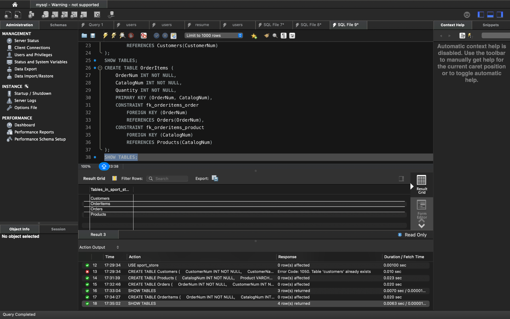

---

## 9. Проверка структуры таблиц

### Customers

```sql
DESCRIBE Customers;
```

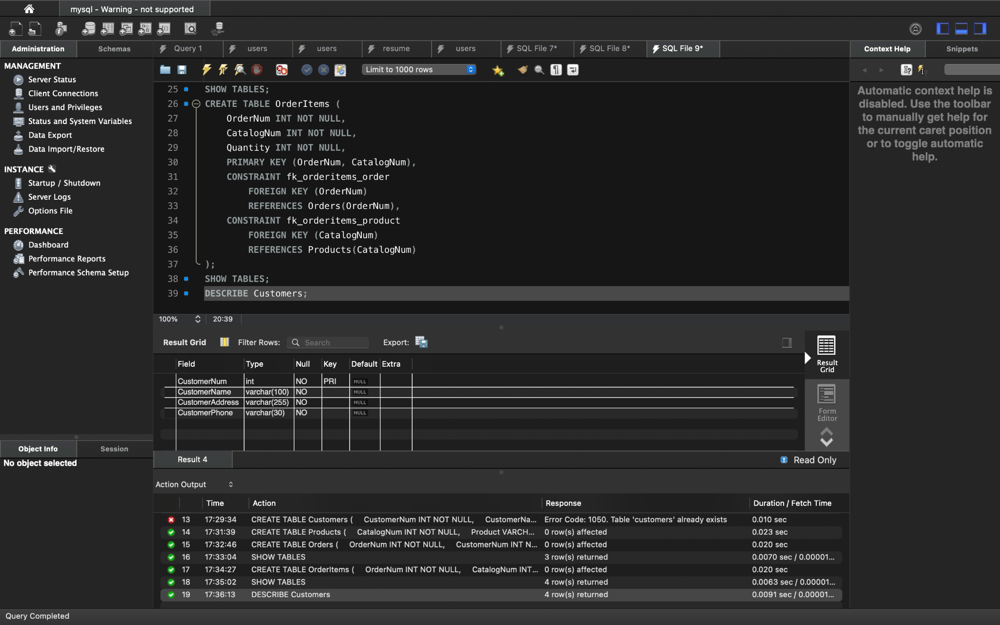

### Orders

```sql
DESCRIBE Orders;
```

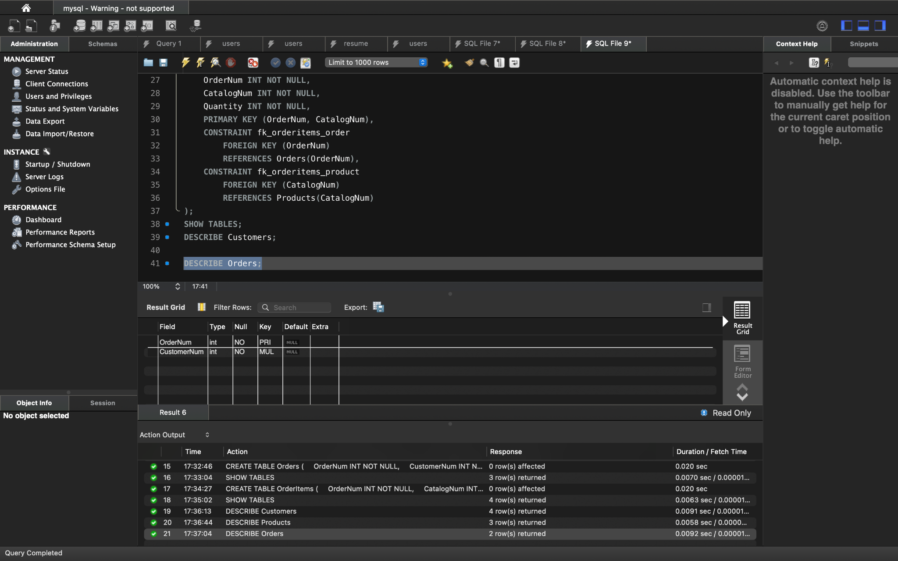

### Products

```sql
DESCRIBE Products;
```

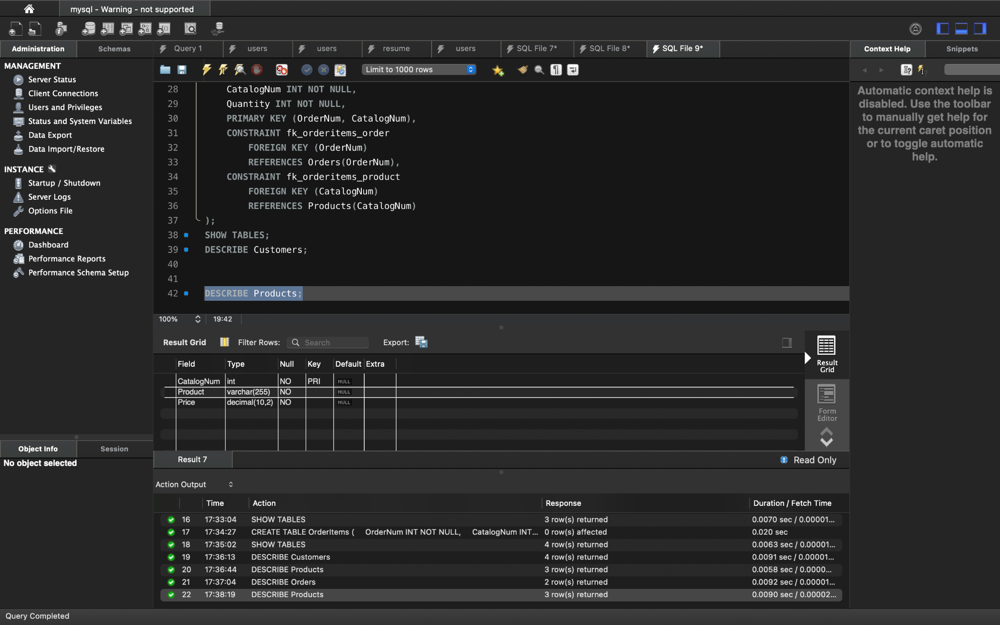

### OrderItems

```sql
DESCRIBE OrderItems;
```

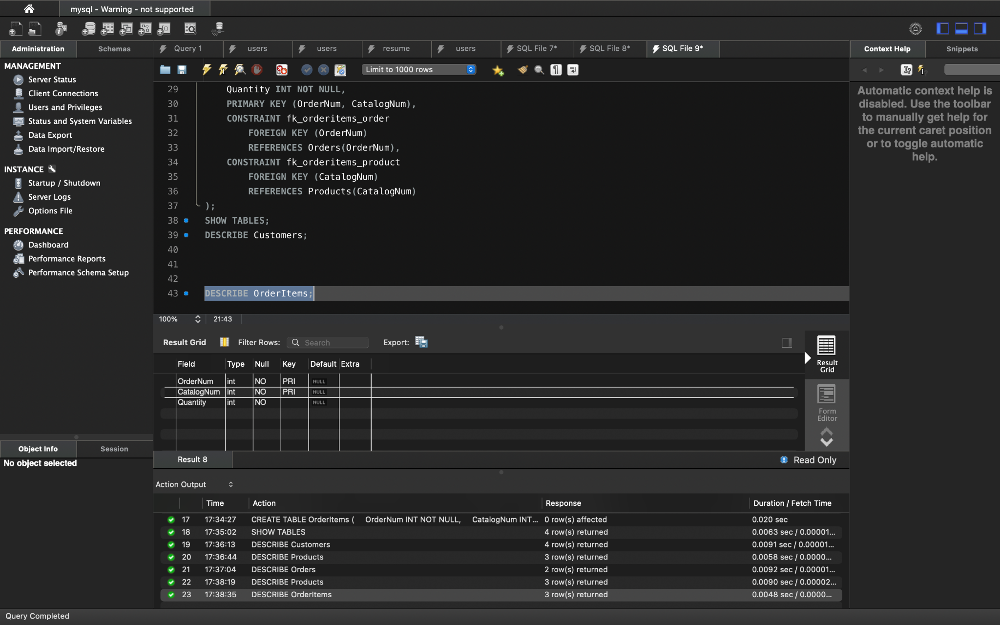

---

## 10. Заполнение таблиц

### Customers

```sql
INSERT INTO Customers
(CustomerNum, CustomerName, CustomerAddress, CustomerPhone)
VALUES
(1, 'Иванов И.И.', 'СПб, ул. Политехническая, 29', '(812)111-11-11'),
(2, 'Петров П.П.', 'СПб, ул. Политехническая, 21', '(812)222-22-22');
```

```sql
SELECT * FROM Customers;
```

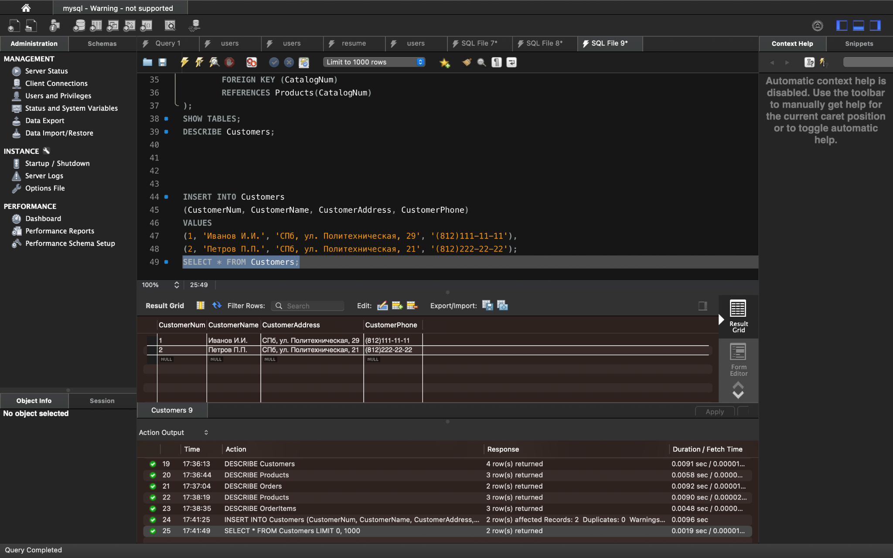

### Products

```sql
INSERT INTO Products
(CatalogNum, Product, Price)
VALUES
(101, 'Рюкзак городской. Модель 1.', 2000.00),
(201, 'Накидка на рюкзак. Модель 2.', 4000.00),
(102, 'Рюкзак туристический. Модель 2.', 4000.00);
```

```sql
SELECT * FROM Products;
```

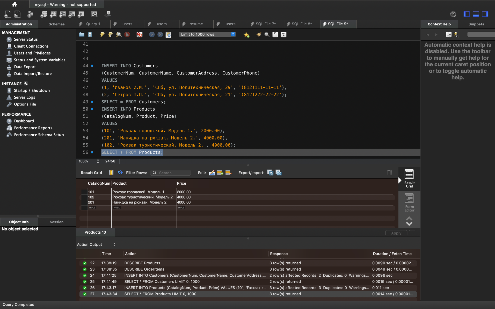

### Orders

```sql
INSERT INTO Orders
(OrderNum, CustomerNum)
VALUES
(1000, 1),
(1001, 2),
(1002, 2);
```

```sql
SELECT * FROM Orders;
```

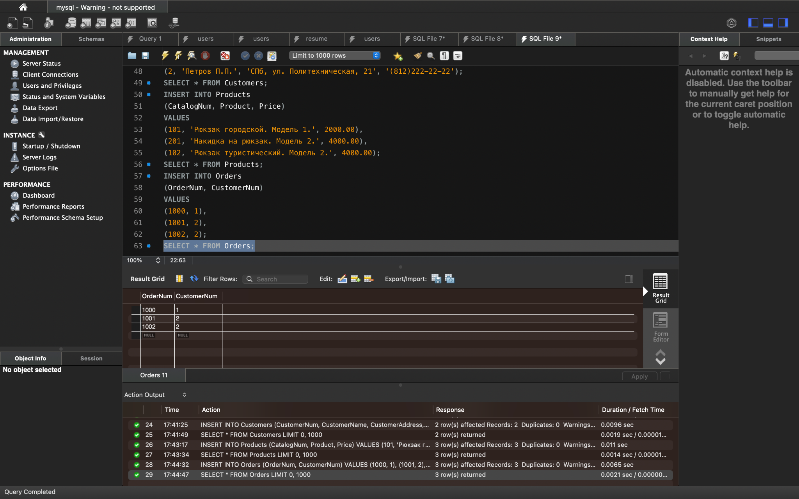

### OrderItems

```sql
INSERT INTO OrderItems
(OrderNum, CatalogNum, Quantity)
VALUES
(1000, 101, 1),
(1000, 201, 1),
(1001, 101, 2),
(1002, 102, 1);
```

```sql
SELECT * FROM OrderItems;
```

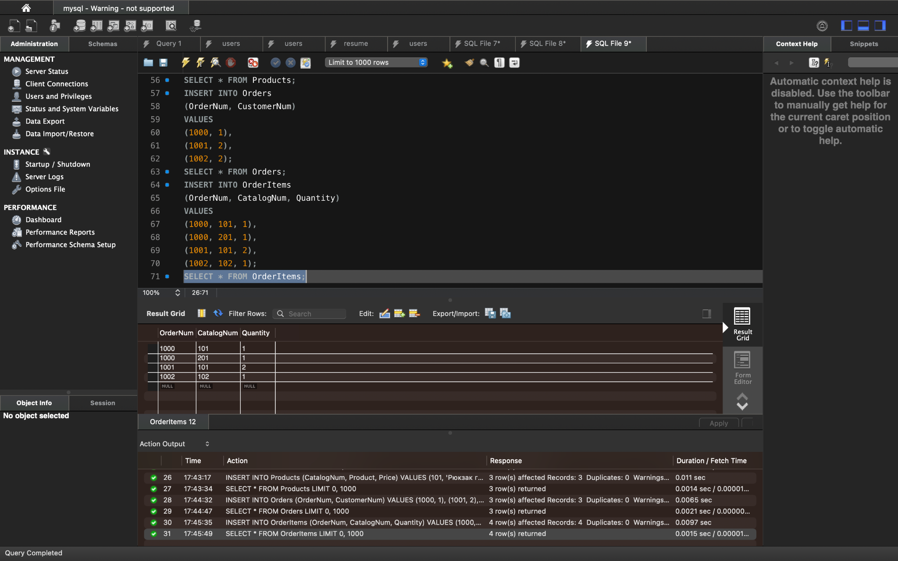

---

# Вариативная часть. Простые запросы на SQL

Для выполнения вариативной части были созданы таблицы `Book` и `BookInLib`.

## 11. Создание и заполнение таблицы Book

```sql
CREATE TABLE Book (
    BookID INT NOT NULL,
    Author VARCHAR(100) NOT NULL,
    Title VARCHAR(150) NOT NULL,
    Publisher VARCHAR(100) NOT NULL,
    BookYear INT NOT NULL,
    PRIMARY KEY (BookID)
);
```

```sql
INSERT INTO Book
(BookID, Author, Title, Publisher, BookYear)
VALUES
(1, 'Пушкин А.С.', 'Капитанская дочка', 'Азбука', 1998),
(2, 'Пушкин А.С.', 'Евгений Онегин', 'Политехника', 2001),
(3, 'Гоголь Н.В.', 'Мёртвые души', 'Азбука', 1997),
(4, 'Гоголь Н.В.', 'Ревизор', 'Питер', 2002),
(5, 'Толстой Л.Н.', 'Война и мир', 'Политехника', 1999),
(6, 'Толстой Л.Н.', 'Анна Каренина', 'Азбука', 2000),
(7, 'Булгаков М.А.', 'Мастер и Маргарита', 'Питер', 2003),
(8, 'Чехов А.П.', 'Вишнёвый сад', 'Азбука', 1996);
```

```sql
SELECT * FROM Book;
```

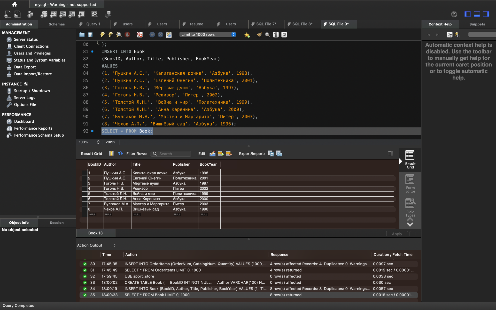

---

## 12. Авторы без повторений и сортировка

```sql
SELECT Book.Author
FROM Book;
```

```sql
SELECT DISTINCT Book.Author
FROM Book;
```

```sql
SELECT DISTINCT Book.Author
FROM Book
ORDER BY Book.Author;
```

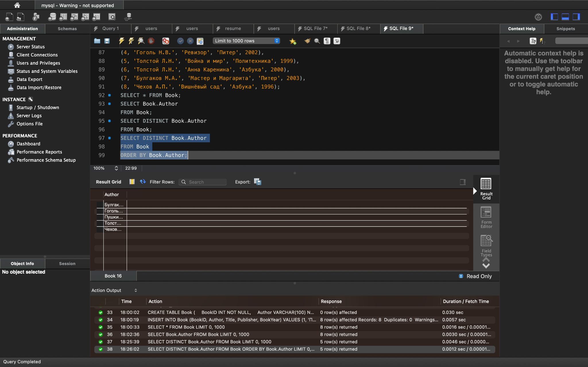

---

## 13. Сортировка по автору и году

```sql
SELECT DISTINCT Book.Author, Book.BookYear
FROM Book
ORDER BY Book.Author ASC, Book.BookYear DESC;
```

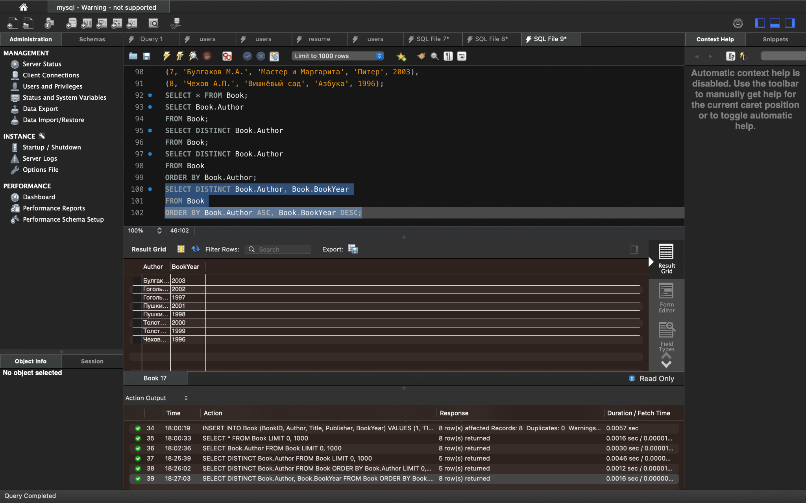

---

## 14. Сортировка книг по году и названию

```sql
SELECT *
FROM Book
ORDER BY BookYear ASC, Title ASC;
```

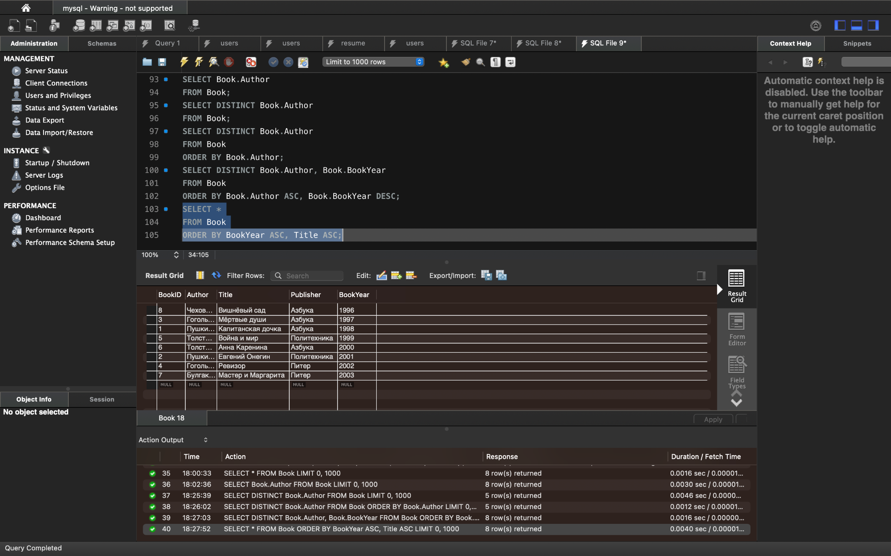

---

## 15. Две самые новые книги

В Microsoft Access используется `TOP`, а в MySQL для ограничения количества строк используется `LIMIT`.

```sql
SELECT *
FROM Book
ORDER BY BookYear DESC
LIMIT 2;
```

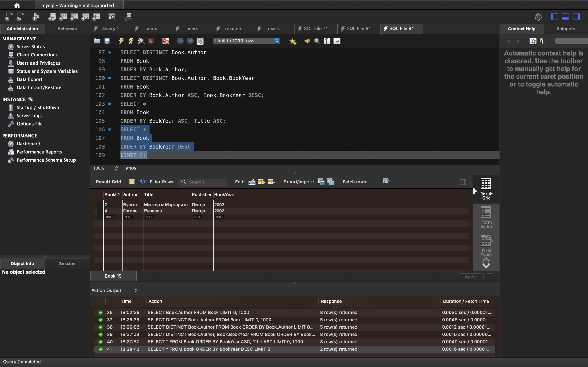

---

## 16. Первая половина списка

В таблице 8 книг, поэтому первая половина списка — 4 записи.

```sql
SELECT *
FROM Book
ORDER BY BookYear ASC
LIMIT 4;
```

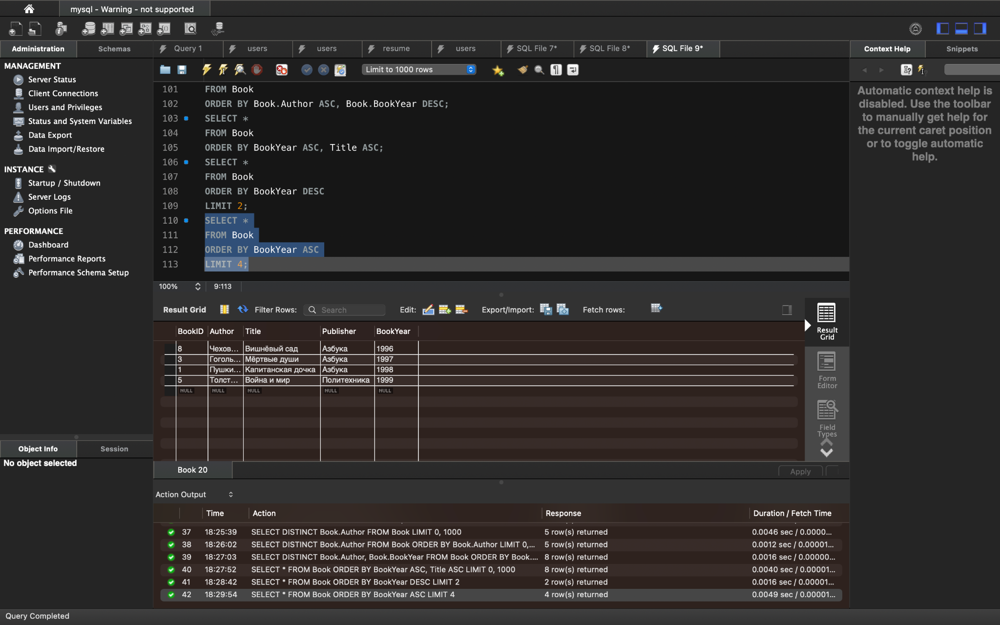

---

## 17. Таблица BookInLib

```sql
CREATE TABLE BookInLib (
    LibID INT NOT NULL,
    BookID INT NOT NULL,
    PRIMARY KEY (LibID, BookID),
    FOREIGN KEY (BookID) REFERENCES Book(BookID)
);
```

```sql
INSERT INTO BookInLib
(LibID, BookID)
VALUES
(1, 1),
(1, 2),
(1, 3),
(2, 5),
(2, 6),
(2, 7);
```

```sql
SELECT * FROM BookInLib;
```

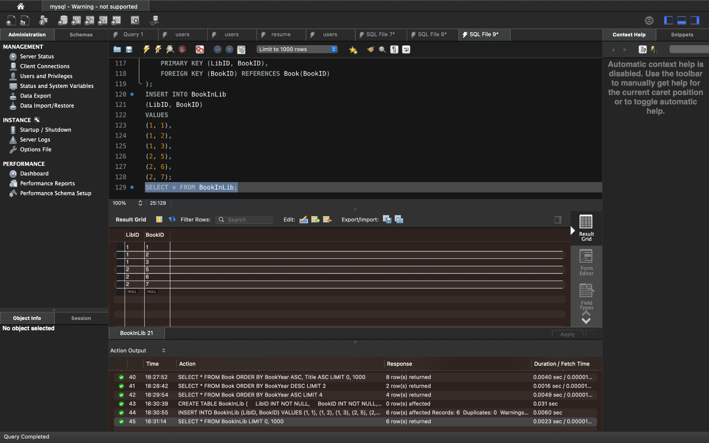

---

## 18. INNER JOIN

```sql
SELECT BookInLib.LibID, Book.Author, Book.Title
FROM Book
INNER JOIN BookInLib
ON Book.BookID = BookInLib.BookID;
```

`INNER JOIN` выводит только строки, для которых есть совпадение в обеих таблицах.

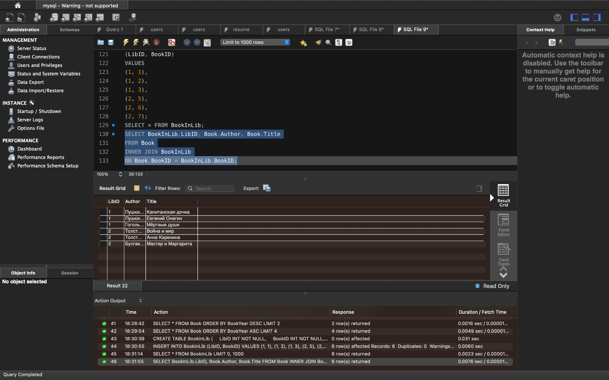

---

## 19. LEFT JOIN

```sql
SELECT BookInLib.LibID, Book.Author, Book.Title
FROM Book
LEFT JOIN BookInLib
ON Book.BookID = BookInLib.BookID;
```

`LEFT JOIN` выводит все строки из таблицы `Book`. Если соответствующей записи в `BookInLib` нет, значение `LibID` будет `NULL`.

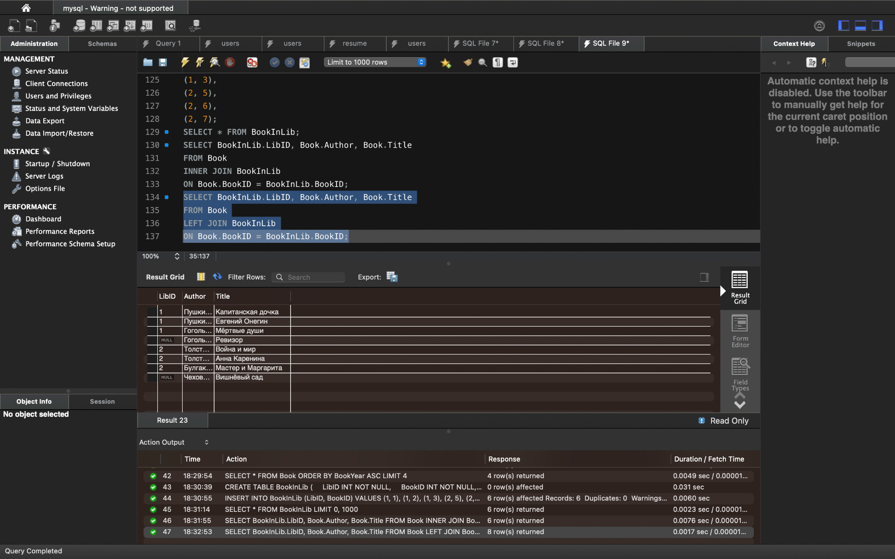

---

## 20. BETWEEN

```sql
SELECT Book.Author, Book.Title, Book.Publisher, Book.BookYear
FROM Book
WHERE Book.BookYear BETWEEN 1997 AND 2001;
```

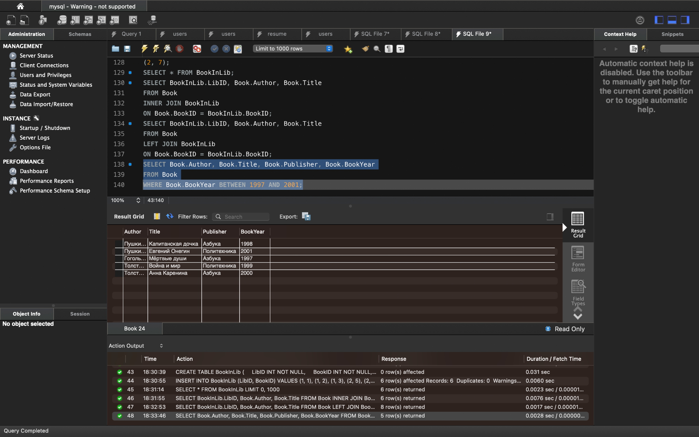

---

## 21. IN

```sql
SELECT Book.Author, Book.Title, Book.Publisher, Book.BookYear
FROM Book
WHERE Book.BookYear BETWEEN 1997 AND 2001
  AND Book.Publisher IN ('Азбука', 'Политехника');
```

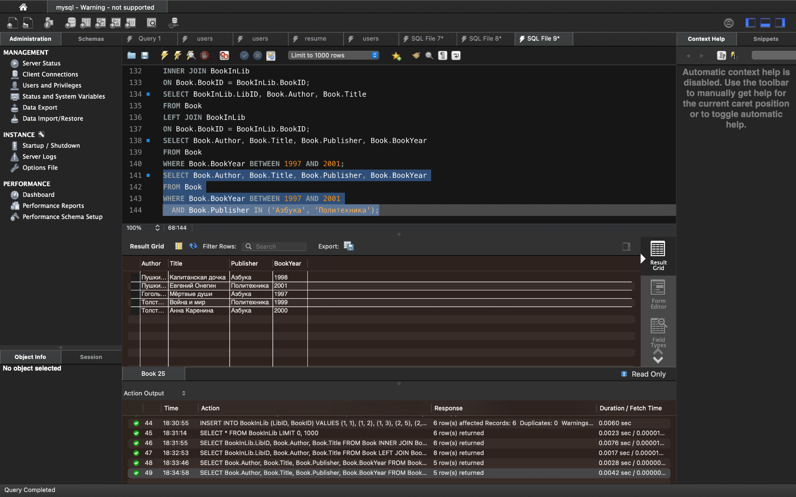

---

## 22. Эквивалент IN через OR

```sql
SELECT Book.Author, Book.Title, Book.Publisher, Book.BookYear
FROM Book
WHERE Book.BookYear BETWEEN 1997 AND 2001
  AND (Book.Publisher = 'Азбука' OR Book.Publisher = 'Политехника');
```

Результат совпадает с запросом через `IN`.

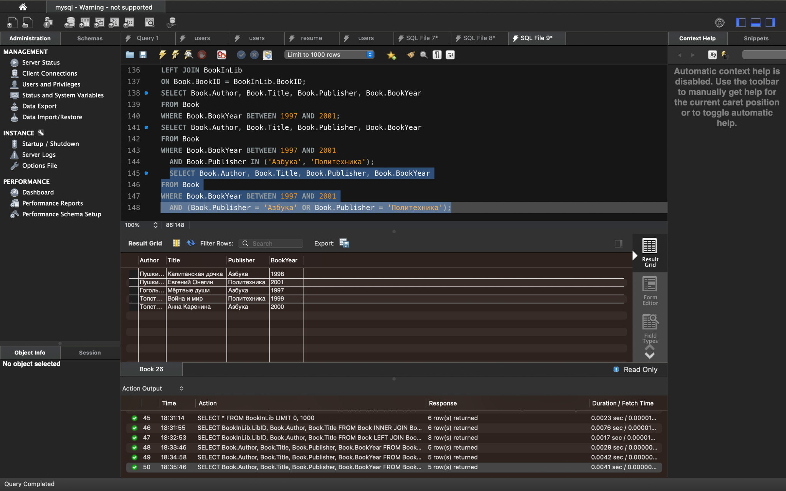

---

## 23. LIKE и сортировка

В MySQL для шаблонов `LIKE` используется `%` вместо `*`, который используется в Access.

```sql
SELECT Title, Author, Publisher, BookYear
FROM Book
WHERE BookYear > 1999
  AND (Author LIKE 'Г%' OR Publisher LIKE '%а')
ORDER BY Title DESC;
```

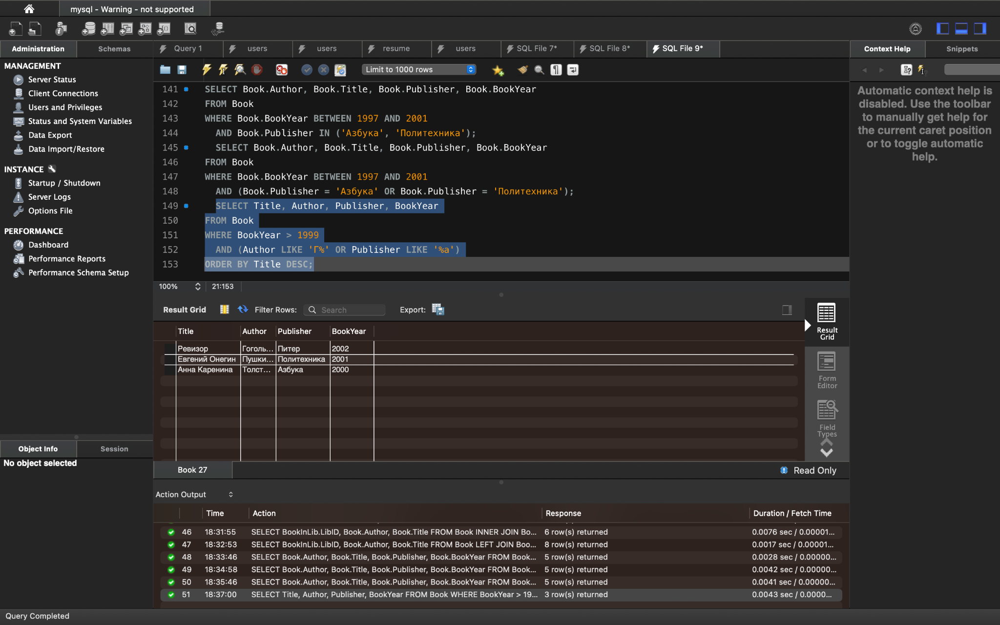

---

## 24. Составное условие с LIKE, AND, OR и NOT

```sql
SELECT *
FROM Book
WHERE Author LIKE 'П%'
   OR (
       BookYear > 2000
       AND Publisher NOT LIKE 'А%'
       AND Publisher NOT LIKE 'П%'
   );
```

В запросе используются `OR`, `AND`, `NOT LIKE` и скобки для задания порядка проверки условий.

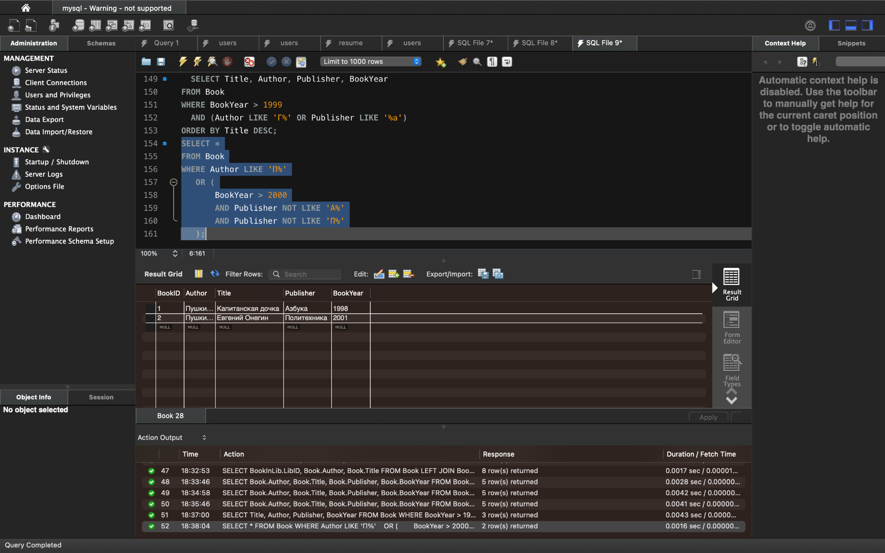

---

## Отличия Microsoft Access и MySQL Workbench

В ходе работы были учтены отличия синтаксиса:

- в Access для шаблонов `LIKE` используется `*`, а в MySQL — `%`;
- вместо `TOP` в MySQL используется `LIMIT`;
- остальные использованные конструкции (`DISTINCT`, `ORDER BY`, `INNER JOIN`, `LEFT JOIN`, `BETWEEN`, `IN`, `AND`, `OR`) работают аналогично.

---

## Вывод

В инвариантной части исходная таблица была приведена к 3НФ и разделена на четыре связанные таблицы: `Customers`, `Products`, `Orders` и `OrderItems`.

В вариативной части были выполнены простые SQL-запросы: выборка данных, удаление повторений, сортировка, ограничение количества строк, соединение таблиц и фильтрация с помощью `WHERE`, `BETWEEN`, `IN`, `LIKE`, `AND`, `OR` и `NOT`.

Также была учтена разница между синтаксисом Microsoft Access и MySQL.
